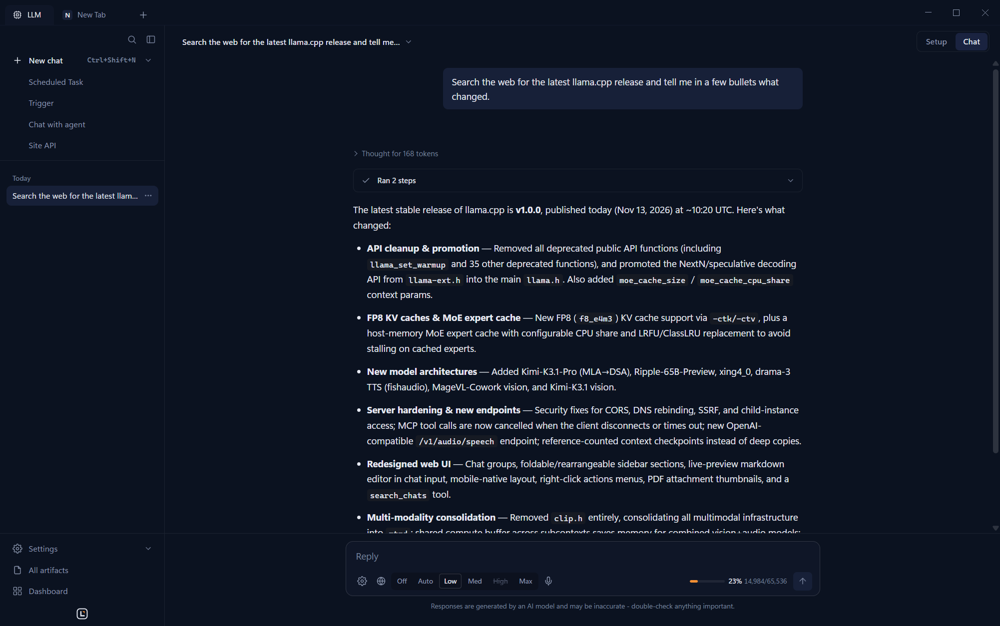

# Agents and coding



## Chat with tools

- Browsing, page reading, file and image tools. The agent opens its own tabs;
  yours stay yours.
- A knowledge base over your PDFs and documents (BM25 plus optional
  embeddings), filled one file at a time or from a whole folder.
- Connect outside MCP servers over stdio, streamable HTTP or SSE.
- Text that comes back from tools, web pages and desktop windows is treated
  as content to read, never as commands to follow.

## Agents

Named sub-agents with their own prompt, tools, model and knowledge, callable
from chat, the API or MCP. Chat can hand a task to Code, Game or any of your
agents as a nested sub-conversation.

## Code mode

A coding agent that also powers the `luma` CLI (see
[cli/README.md](../../cli/README.md)) and the VS Code and JetBrains plugins,
and can build and hot-install LumaBrowser extensions.

## Tool Forge

The agent writes, tests and publishes new sandboxed tools that only get the
network access they declare.

## Site APIs

Turn a tab you are signed in on into named endpoints that return JSON.

- Record the steps once and save them as a reusable endpoint.
- When the site changes and a selector stops matching, the model finds the
  element again from its description and saves the fix.
- Endpoints are exposed as chat tools, MCP tools and REST routes.

## Roleplay mode (add-on)

A narrator with a story memory.

- Each character keeps a profile, a state and a history. The story keeps its
  clock, open threads and a running summary.
- Regenerating or branching a reply rewinds the world to that point. Deleting a reply, editing your last
  message, or carrying on from a regenerated reply all continue from the branch on screen: the history, the
  cast, the place and the story record are that branch's.
- The model picked in the composer's gear is the story's model from the next reply.
- Reply length, tone and narrator thinking are set from the composer.

## Connecting outside agents

### MCP

LumaBrowser can write its MCP entry into Claude Code, Cline, Codex, OpenCode
and JetBrains Air for you from **Settings > Editors & agents**, or export the
config to a file. By hand it looks like this:

```json
{
  "mcpServers": {
    "luma-browser": {
      "command": "node",
      "args": ["<install dir>/resources/app.asar.unpacked/mcp-server.js"],
      "env": { "LUMA_API_PORT": "3000" }
    }
  }
}
```

The server starts LumaBrowser if it is not running. Tools cover browsing, tabs,
page reading and extraction, agents, timed tasks, page monitors, and any MCP
servers you have connected to LumaBrowser.

### Agent Client Protocol

`luma acp` speaks the Agent Client Protocol over stdin and stdout, so editors
that host ACP agents (JetBrains Air, Zed) can run your LumaBrowser agents in
their own chat panel. Tool calls show as the editor's own cards with diffs and
command output, and tools that change something ask for permission in the
editor. The work happens in the running LumaBrowser, started hidden when it is
not up.

```sh
luma acp                  # answers as the Code agent
luma acp --agent <name>   # answers as one of your named agents
```

The JetBrains Air entry can be written for you from the same Settings page as
the MCP entry.

### WebDriver and CDP

Both are off by default. Turn them on in Settings, then:

```python
# Selenium (W3C WebDriver), default 127.0.0.1:9515
driver = webdriver.Remote("http://127.0.0.1:9515", options=options)
```

```js
// Puppeteer or Playwright (Chrome DevTools Protocol), default 127.0.0.1:9222
const browser = await puppeteer.connect({ browserURL: 'http://127.0.0.1:9222' });
```

Clients only see the tabs automation created, never your own. Either driver can
ask the LLM to resolve a selector that stopped matching.

### REST and local model APIs

The full API reference (REST, MCP tools and the OpenAI and Anthropic
compatible local API) lives at [lumabyte.com/apis](https://lumabyte.com/apis).
