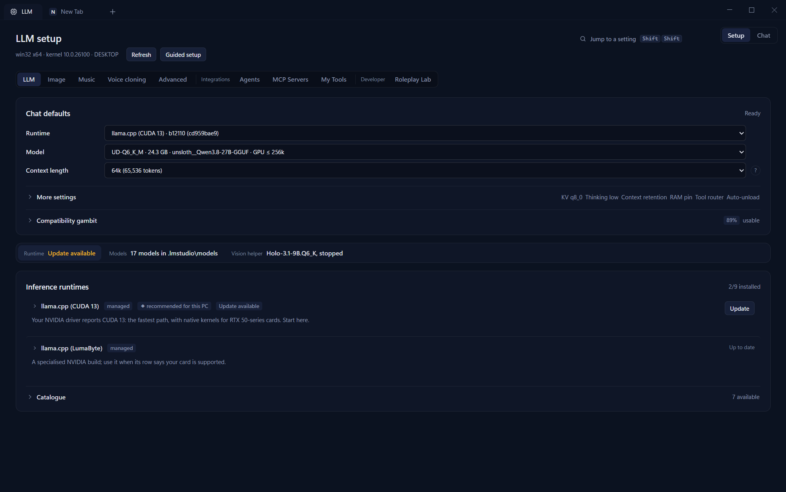

# Local models

LumaBrowser runs language models on your own hardware and works out the
launch settings for you.

## Finding a model

- Search Hugging Face from the app. Results sort by trending and show
  parameters, context length and architecture, with a fit dot per row and a
  "Fits this PC" toggle.
- Every quantization gets a fit badge and a predicted speed before you
  download it.
- Models you already have in LM Studio, Ollama or the Hugging Face cache can
  be linked without downloading them again.
- Downloads are pinned to one commit, checked by SHA-256 and size, resumed
  after a network error, and refused when the disk is too full.
- A downloaded model takes the sampler settings its model card recommends.

## Runtimes

| Runtime | Hardware |
|---|---|
| llama.cpp CPU | Any machine |
| llama.cpp CUDA 12 and CUDA 13 | NVIDIA |
| llama.cpp Vulkan | NVIDIA, AMD, Intel, Qualcomm Adreno |
| llama.cpp ROCm | AMD, with the AMD HIP SDK (Windows) or ROCm (Linux) |
| llama.cpp SYCL | Intel Arc and Core Ultra graphics |
| llama.cpp OpenVINO (experimental) | Intel GPUs and NPUs |
| llama.cpp OpenCL | Qualcomm Adreno on Windows on Arm |
| llama.cpp Metal, MLX | Apple Silicon |
| ik_llama.cpp, NInfer | Add-ons, x64 only |

Each runtime is marked "recommended" or "not for this PC" with the reason, and
shows an Update button only when a newer release exists.

## Fitting a model to your hardware

- Sizes each model and its KV cache to your video memory and chooses full,
  partial or CPU offload.
- Planning starts from a live reading of what other apps already hold, with a
  "GPU headroom" setting per card. A model that fits whole on one card only by
  using half of that headroom still loads there, because a slower second card
  or the CPU costs far more speed; the plan notes say when that happened.
- A banner warns when a card the model sits on runs short of free video memory.
  It can be turned off under Chat defaults, More settings (Low VRAM warning);
  unload on VRAM pressure keeps working either way.
- Moves MoE experts to the CPU when that is faster. A MoE model too large for
  video memory keeps its experts in RAM and uses spare video memory as an
  expert cache.
- Splits one model across several GPUs, or across other machines over
  llama.cpp RPC.

## Speed

- **Speculative drafters:** for supported models (Qwen3.8-27B, Muse Glimmer
  30B) the matching DFlash2 drafter downloads with the model. A per-model
  dialog picks the drafter, the built-in MTP head, or none. Measured on an RTX
  5090 with Qwen3.8-27B: 140 tok/s with the drafter against 58 plain.
- **Long conversations stay fast:** the request prefix is kept stable so
  llama-server reuses its cache between turns, and a compaction summary is
  stored with the conversation and reused.
- **Helper model:** an optional small second model kept loaded for a mode's
  bookkeeping calls, so they never take the main model's slot or its cache.

## Per-model settings

- Local models are grouped by family and size, one row per quantization.
- Each model has its own Tune panel: thinking, temperature and samplers, reply
  limit, context, extra llama.cpp flags, run timeout and run steps.
- Named profiles save a set of those and switch between them.

## Testing a model (add-on)

The Model Testing add-on adds a "Model testing" tab to Setup.

- Pick any downloaded model and the tests to run against it. A model other
  than your default is loaded for the run and your default is put back after.
- The compatibility gambit grades a model on the work the app gives it:
  following instructions, holding a conversation, driving the browser, picking
  tools, answering correctly, building an artifact and finishing a turn
  without looping. It takes 30 to 60 minutes.
- Each test keeps its latest result per model, and the full transcripts of the
  last run can be downloaded.

## Other providers and the local API

- Works with any OpenAI-compatible endpoint (LM Studio, Ollama, vLLM), with
  Anthropic, and with another LumaBrowser on your network.
- An optional local API speaks the OpenAI (Chat Completions and Responses) and
  Anthropic formats on `http://127.0.0.1:8317`. Off by default.
- The full reference is at [lumabyte.com/apis](https://lumabyte.com/apis).
