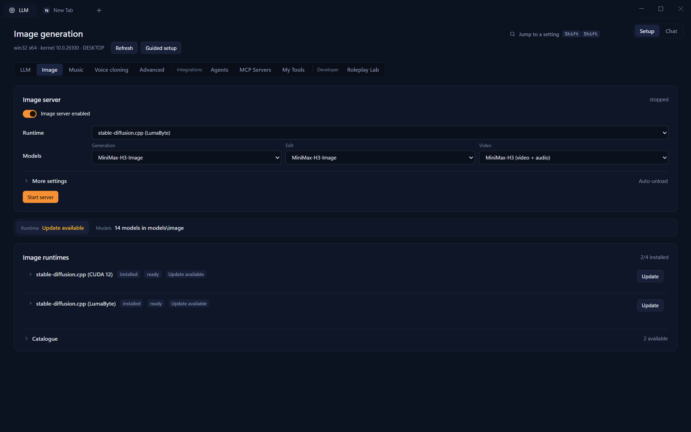

# Images, video, music and voice

All of it runs locally, on the same GPUs the language models use.

## Image models

FLUX.1 Schnell, FLUX.1 Kontext dev, FLUX.2 klein (4B and 9B), FLUX.3 Image
Klein, Qwen-Image and Qwen-Image-Edit, MiniMax-H3-Image, MOSS-Image, Krea 2
Turbo, Z-Image Turbo, Chroma, SDXL and SD 1.5.

- LoRA support, and import from Hugging Face, a URL or a local file.
- Some models carry non-commercial or territory-limited licenses. Each row in
  the app has a license note; read it before commercial use.

## Browse CivitAI

- Search and install checkpoints from inside the app, or paste a civitai.com
  link.
- Each version carries an install verdict, so one the server cannot run says
  so before you click Install.
- Steps, CFG, sampler, scheduler and size defaults are derived from the
  creator's notes and sample images, with the source of each recorded.
- Downloads are verified by size and SHA-256.

## Image editing

- **Mark an area:** paint a region on any image and only that area changes.
  Everything outside it is restored pixel for pixel from the original.
- **Extend a picture (outpaint):** ask for a wider or taller frame and the
  original is kept whole while the new space is painted in.
- **Reference edits:** edit from several reference pictures on models that
  support it.
- **Unchanged parts stay unchanged:** after a whole-image edit, parts the
  model did not visibly alter are restored from the source, so repeated edits
  do not drift.

## Media viewer

Images and videos open in a viewer with zoom and pan, a filmstrip of the
conversation, frame stepping for video, a details drawer (prompt, model, seed,
steps, sampler) and a theater mode.

## Video

Wan 2.2 (text to video and image to video), LTX-Video, AniSora and MiniMax-H3.

## Music

MiniMax-Music3 (CUDA, Linux or WSL2, about 34 GB of video memory).

## Voice

- **Speech to text:** Parakeet, Qwen3-ASR and whisper.cpp.
- **Text to speech:** Kokoro, Pocket TTS, KittenTTS and Piper voices.
- **Voice cloning:** Chatterbox and KittenTTS 2.
