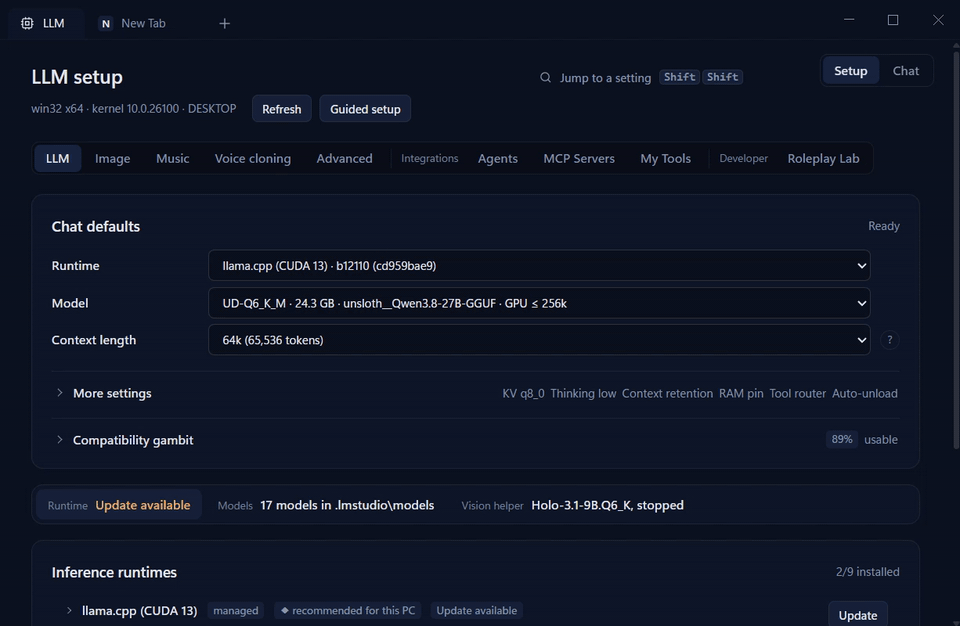
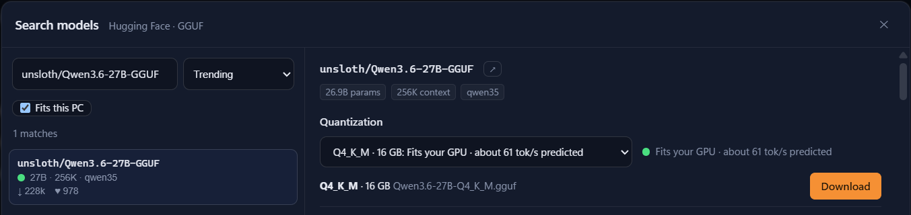

<p align="center">
  
</p>

<h1 align="center">LumaBrowser</h1>

<p align="center">
  <b>Your local AI stack in one app.</b><br>
  A web browser that runs language, image, video and voice models on your own
  GPUs, and lets agents work in the tabs you are already signed in to.
</p>

<p align="center">
  <a href="https://github.com/amurgola/LumaBrowser/releases/latest"><b>Download</b></a> ·
  <a href="Documentation/features/README.md">Features</a> ·
  <a href="https://lumabyte.com/apis">API docs</a> ·
  <a href="https://lumabyte.com">Website</a>
</p>

<p align="center">
  Free · Open source (AGPL-3.0) · Windows, macOS and Linux
</p>

<p align="center">
  
</p>

## Download

Get the file for your computer from the
**[latest release](https://github.com/amurgola/LumaBrowser/releases/latest)**
(under "Assets"), then open it.

| Your computer | File to download |
|---|---|
| Windows | `LumaBrowser.Setup.<version>.exe` (or the `portable` one, which needs no install) |
| Windows on Arm (Snapdragon X) | `LumaBrowser.Setup.<version>-arm64.exe` |
| Mac (Apple Silicon) | `LumaBrowser-<version>-arm64.dmg` |
| Linux | `LumaBrowser-<version>.AppImage`, or `-arm64.AppImage` on Arm |

Or, with Node 18 or newer, fetch and launch the latest build from a terminal:

```sh
npx lumabrowser start
```

## One app instead of five

Most local AI setups are a pile of separate tools. LumaBrowser is those tools
as one desktop app that shares your GPUs, your models and your browser.

| What people run today | In LumaBrowser |
|---|---|
| A model server (Ollama, LM Studio, llama.cpp) | Runtimes for every GPU vendor, with each model sized to your hardware before you download it |
| A chat interface | Chat with web browsing, files, a knowledge base and your own agents |
| An image tool | Image, video and music generation, plus area editing and outpainting |
| A voice stack | Speech to text, text to speech and voice cloning |
| A headless browser for agents | Your real browser, with your logins, over MCP, ACP, WebDriver and CDP |
| A cloud computer-use service | Desktop control that runs locally: no per-step cost, and screenshots never leave the machine |

## First run

**1. Pick a model.** Open **Models** and search. LumaBrowser reads your
hardware and puts a fit badge and a predicted speed on every model before you
download it. Models you already have in LM Studio, Ollama or the Hugging Face
cache can be linked without downloading them again.

<p align="center">
  
</p>

**2. Give it a task.** Open a chat and ask for something that needs the web:

> Search the web for the latest llama.cpp release and tell me in a few bullets what changed.

The agent opens its own tabs, reads the pages and answers. Your tabs stay yours.

**3. Connect what you already use.** Point Claude Code, Codex, Cline, OpenCode
or your editor at it from **Settings > Editors & agents**.

## What is inside

| | |
|---|---|
| **[Browser](Documentation/features/browser.md)**<br>A Chromium browser with an ad blocker, Chrome extensions, a password manager, private windows, and a Shift Shift search for any setting or chat. | **[Local models](Documentation/features/local-models.md)**<br>llama.cpp and MLX runtimes for NVIDIA, AMD, Intel, Qualcomm and Apple hardware. Splits a model across GPUs or machines, and speeds it up with a drafter. |
| **[Images, video, music and voice](Documentation/features/media.md)**<br>FLUX, Qwen-Image, MiniMax-H3, Wan 2.2 and more, a CivitAI browser, and edits that change only the area you paint. | **[Agents and coding](Documentation/features/agents.md)**<br>Named agents, a coding agent that also runs in your terminal and editor, tools the agent writes for itself, and signed-in sites turned into APIs. |
| **[Computer use](Documentation/features/computer-use.md)**<br>The agent operates other apps on your desktop, shows which window it is in, and always asks before a password field or a checkout. | **[Automation](Documentation/features/automation.md) and [sharing](Documentation/features/sharing.md)**<br>Triggers, page watches and recurring tasks. Share your models and GPUs with your other devices, or a live tab by link. |

What changed in each version is in the
[release notes](https://github.com/amurgola/LumaBrowser/releases).

## For your agents and tools

| You want to... | Use |
|---|---|
| Let Claude Code, Codex, Cline or OpenCode use a real browser | The MCP server, written into their config for you from Settings |
| Run your LumaBrowser agents inside JetBrains Air or Zed | `luma acp` (Agent Client Protocol) |
| Point Selenium, Puppeteer or Playwright at it | WebDriver on `127.0.0.1:9515`, CDP on `127.0.0.1:9222` (both off by default) |
| Call local models from your own code | The OpenAI and Anthropic compatible API on `127.0.0.1:8317` (off by default) |
| A coding agent in your terminal or editor | The `luma` CLI ([cli/README.md](cli/README.md)) and the VS Code and JetBrains plugins |

Setup for each is in
[Agents and coding](Documentation/features/agents.md#connecting-outside-agents),
and the full API reference is at [lumabyte.com/apis](https://lumabyte.com/apis).

## Will it run on my computer?

| Tier | Video memory | What runs well |
|---|---|---|
| Laptop | under 8 GB, or no GPU | Small LLMs, speech, voices; image generation needs 8 GB |
| Gaming | 8 to 24 GB | Mid-size LLMs, image generation |
| High-end | 24 GB or more, or a Mac with 32 GB+ | Large LLMs, video; music needs about 34 GB |

Tiers use your largest single card, since cards do not add up for most
workloads (LLMs are the exception: they can split across cards).

| GPU | Support |
|---|---|
| NVIDIA | CUDA 12 and CUDA 13 (recommended for RTX 50) on Windows; Vulkan or CUDA on Linux |
| AMD | Vulkan on Windows and Linux; ROCm when the AMD HIP SDK (Windows) or ROCm (Linux) is installed |
| Intel | Vulkan on Windows and Linux; SYCL for Arc and Core Ultra graphics; OpenVINO (experimental) for Intel GPUs and NPUs |
| Qualcomm Adreno (Windows on Arm) | OpenCL for LLMs |
| Apple Silicon | MLX or llama.cpp (Metal) for LLMs; CPU for image generation |
| None | CPU builds of every runtime |

## What leaves your machine

Your browsing, chats, models, generated media and files stay on your machine.
Nothing you type into a chat is sent anywhere unless you choose a cloud model.
This is everything that does go out, and how to turn it off:

| What | Sent to | Default | Turn off |
|---|---|---|---|
| Usage ping: version, platform, machine id, every 5 minutes | lumabyte.com | On | Settings > Privacy & permissions > Usage data |
| Update check | lumabyte.com | On | Settings > About > Updates |
| Extension catalog | lumabyte.com | Only when you open Extensions | |
| Chrome extension downloads and update checks: extension id, Chromium version | Google (clients2.google.com) | Only when you install or update one | |
| CivitAI searches, model pages, thumbnails and downloads (with your CivitAI key, if you set one) | civitai.com | Only when you open Browse CivitAI | |
| Ad-block lists, runtimes, models | Ghostery, GitHub, Hugging Face and model hosts | When needed | |

No feature depends on the usage ping.

**Security.** Browser automation hands an agent your browser: anything an MCP,
WebDriver or CDP client can see, the model behind it can see. Connect only
agents you trust, keep those ports on localhost (the default), and set an API
key in **Settings > API & MCP** before you expose the REST API on port 3000,
which needs no key by default. Text from tools, web pages and windows is
treated as content to read, never as commands, and saved passwords are never
shown to a model.

## Docker and development

<details>
<summary>Run it on a server with Docker</summary>

The Docker image runs the full app headless and serves the desktop in your
browser over noVNC. It is meant for servers and agent hosts.

```sh
LUMA_VNC_PASSWORD=change-me docker compose up -d
```

- `http://localhost:6080`: the app, through noVNC.
- `http://localhost:3000`: REST API and MCP proxy.

In Docker the API accepts any address and needs no key by default. Do not
publish port 3000 to a network you do not trust without setting an API key.
GPU acceleration is not used in the container.

</details>

<details>
<summary>Build from source</summary>

You need Node 20 and a C++ toolchain (Visual Studio 2022 Build Tools on
Windows) for the native SQLite module.

```sh
npm install
npm run dev          # start the app in developer mode
npm test             # unit tests under Electron
npm run test:e2e     # end-to-end suites
npm run build        # installers for the current platform
npm run shots:readme # retake this README's screenshots and demo clip from a blank-slate app
npm run readme:check # word budget, links and images of this README
```

The [Documentation](Documentation/index.md) folder is written for coding agents
as much as for people. Every code file has a matching doc at
`Documentation/<same path>.md`, and
[Documentation/index.md](Documentation/index.md) lists them all in one line
each. Point your agent at the index first, and have it update the doc whenever
it changes the file.

</details>

## Contributing

Bug reports and pull requests are welcome. Read [CONTRIBUTING.md](CONTRIBUTING.md)
first: contributions need a signed Contributor License Agreement.

## License

LumaBrowser is free software under the
[GNU Affero General Public License v3.0 or later](LICENSE). You may use it,
study it, change it and redistribute it. If you distribute a modified version,
or run one for other people over a network, you must publish your changes
under the same license. Running unmodified official builds, including inside a
company, needs nothing more. Organizations that want to keep their
modifications private, combine LumaBrowser with proprietary software, or ship
private extensions can obtain a
[commercial license](COMMERCIAL-LICENSE.md) from Lumabyte, LLC.

LumaBrowser is owned and maintained by Lumabyte, LLC, an Ohio company, which
also runs [lumabrowser.com](https://lumabrowser.com) and
[lumabyte.com](https://lumabyte.com). If you distribute a modified version,
mark it as modified and do not present it as an official LumaBrowser release
(AGPL section 7(c), see [LICENSE](LICENSE)). Third-party components keep their
own licenses, listed in [THIRD-PARTY-LICENSES](THIRD-PARTY-LICENSES).
